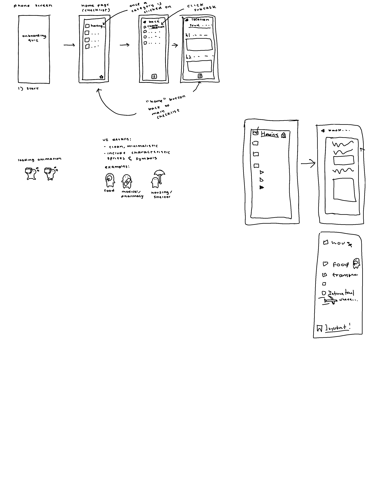
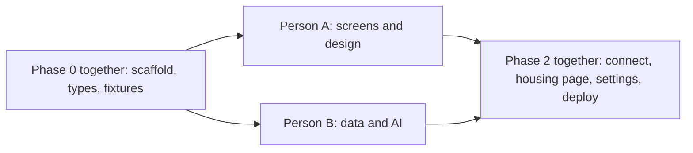
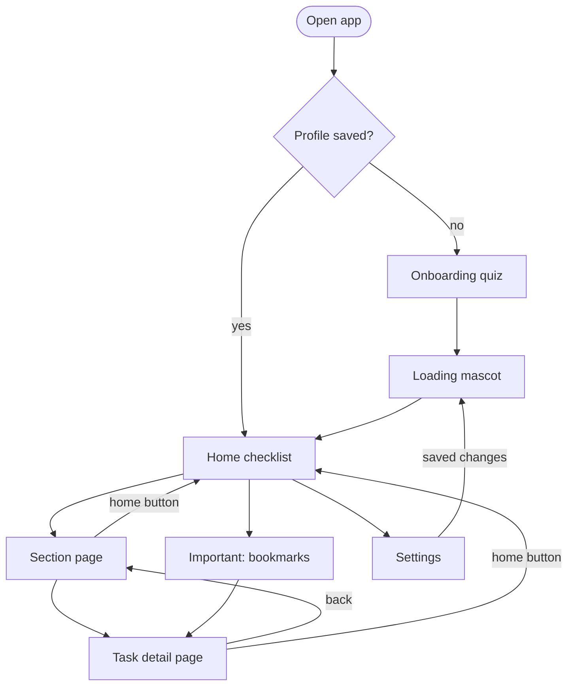

# Movingly: Build Plan

Movingly (temporary name) is a mobile-first web app that streamlines moving. A short onboarding quiz learns about the move (where, who, budget, daily life), then Gemini turns a fixed checklist template into a personalized moving checklist with detailed task pages (housing recommendations, commute checks, nearby places, visa rules for international moves). Users can bookmark pages into an "Important!" list and change any quiz answer later from Settings.

Original sketch (screens, mascot sprites, loading animation):



---

## 1. Stack

| Piece | Choice |
| --- | --- |
| App | Next.js (App Router) + TypeScript + Tailwind CSS, mobile-first web app |
| Auth | Firebase Auth: anonymous sign-in on first visit (no login wall), link a Google account from Settings |
| Database | Cloud Firestore |
| LLM | Gemini API via the `@google/genai` SDK, called only from Next.js server routes |
| Maps | Google Maps Platform: Maps JavaScript API, Places API (New), Routes API (via `@vis.gl/react-google-maps` on the client) |
| Validation | `zod` schemas shared by the client, the server, and Gemini structured output |
| Hosting | Firebase App Hosting (deploys Next.js from GitHub) |

---

## 2. Human setup (things a Cursor agent cannot do)

Agents can write all of the code, but these steps need a logged-in human, a browser, or a credit card. Do them before Phase 0 (section 3.1).

- [ ] **GitHub access.** Add your teammate as a collaborator on this repo (Settings > Collaborators). Both of you connect GitHub to Cursor.
- [ ] **Firebase project.** Create one project at [console.firebase.google.com](https://console.firebase.google.com). Add your teammate as an Owner or Editor (Project settings > Users and permissions).
- [ ] **Billing.** Upgrade the project to the Blaze (pay-as-you-go) plan. Google Maps APIs and App Hosting require billing. Set a budget alert (for example $20) in Google Cloud Billing > Budgets and alerts.
- [ ] **Firebase Auth.** In Authentication > Sign-in method, enable **Anonymous** and **Google**. After the first deploy, add the App Hosting domain under Authentication > Settings > Authorized domains.
- [ ] **Firestore.** Create a Firestore database (production mode, region close to you).
- [ ] **Web app config.** In Project settings > General, register a Web app and copy the config values into the `NEXT_PUBLIC_FIREBASE_*` variables (section 13).
- [ ] **Google Maps APIs.** In the same Google Cloud project, enable **Maps JavaScript API**, **Places API (New)**, and **Routes API**. Create two API keys:
  - Browser key: restrict to HTTP referrers `http://localhost:3000/*` and your deploy domain, and to the Maps JavaScript API and Places API (New).
  - Server key: restrict to Places API (New) and Routes API only.
- [ ] **Gemini API key.** Already have it (from [Google AI Studio](https://aistudio.google.com)). Check its rate limits; link billing in AI Studio if the free tier is too slow for the demo.
- [ ] **Share secrets privately.** Put every key in a `.env.local` file on each computer (never commit it). Share keys through a password manager or direct message, not in the repo or in an agent chat.
- [ ] **If you use Cursor Cloud Agents:** add the same variables in the Cursor Dashboard (Cloud Agents > Secrets) so cloud agents can run the app.
- [ ] **Firebase CLI login.** On each computer run `npm i -g firebase-tools` and `firebase login` (opens a browser). Agents can then run `firebase deploy --only firestore:rules`.
- [ ] **App Hosting connection.** In the Firebase console > App Hosting, create a backend connected to this GitHub repo (`main` branch). This uses a GitHub OAuth popup. Store server secrets with `firebase apphosting:secrets:set GEMINI_API_KEY` (and `GOOGLE_MAPS_SERVER_KEY`).
- [ ] **Mascot art.** Draw or export the mascot sprites (section 5) as transparent PNG or SVG. Agents can make placeholder SVGs, but the hand-drawn style should come from you.
- [x] **Answer the open questions** (decisions recorded in section 16).

---

## 3. Work split (two people, each using Cursor)

Two tracks run in parallel: **Person A (frontend: screens and design)** and **Person B (backend: data and AI)**. They only work in parallel smoothly if the shared pieces are agreed first, so Phase 0 is done together on one computer.



### 3.1 Phase 0: together, on one computer

- [ ] Human setup from section 2 is done.
- [x] Scaffold with `create-next-app` (Next.js 16.4: TypeScript, Tailwind, App Router, `src/` directory, ESLint, Cache Components on).
- [x] Install: `firebase`, `firebase-admin`, `@google/genai`, `zod`, `@vis.gl/react-google-maps`, and `vitest` (dev).
- [x] `src/lib/types.ts`: zod schemas and types for `Profile`, `Checklist`, `Task`, `TaskDetail`, `DetailBlock`, `FactPack`, `Bookmark`, `TaskTemplate`, and the four API request and response shapes (section 11).
- [x] `src/lib/fixtures/`: `profile.international.json`, `profile.domestic.json`, `checklist.sample.json`, `taskDetail.areaSearch.json`, `taskDetail.generic.json`, exported already validated from `@/lib/fixtures`. A test fails if a fixture drifts from the types.
- [x] `src/lib/firebase/client.ts`: lazy Firebase init, `ensureSignedIn()` (anonymous sign-in), `getIdToken()` for API calls.
- [x] `.env.example` (section 13), `firestore.rules` and `firebase.json` (section 11), `apphosting.yaml` (fill in the `REPLACE_ME` values).
- [x] `AGENTS.md`: tells every agent to read this plan, respect file ownership (section 3.4), and run the checks before finishing.
- [x] Scripts: `npm run dev`, `lint`, `typecheck`, `test`, `build`.
- [x] Push to `main`. Both people pull it and branch from it.

### 3.2 Person A: frontend (screens and design)

Build against the fixtures first; swap in real data in Phase 2.

- [ ] **A1. App shell.** Phone-width layout (`max-w-md`, centered), top back button, bottom-center Home button, settings gear, empty routes for every screen (section 12).
- [ ] **A2. Onboarding quiz.** Declarative question config in `src/lib/quiz/questions.ts` (section 6), one question per screen, 4-part progress bar, Back/Next/Skip, Places autocomplete input, pin editor (max 5), chips, sliders, budget input with rent/buy label switch. Saves answers after every step (through Person B's `saveProfile`, or local state until it exists). "Build my checklist" leads to the loading screen.
- [ ] **A3. Home.** Section rows with sprite, checkbox, and progress ("3/7"); done tasks struck through; "Important!" bookmark row pinned at the bottom; settings gear bottom-right.
- [ ] **A4. Section page.** Back button, bookmark toggle, task rows with checkboxes, collapsible Rent or Buy sublist with a triangle toggle, Home button.
- [ ] **A5. Task detail page.** Renderer for every `DetailBlock` type, location line with a place search field, map card, bookmark toggle, back and Home buttons.
- [ ] **A6. Important page.** List of bookmarked section and task pages; tapping opens the page.
- [ ] **A7. Settings page.** Lists the four quiz sections with a summary of answers; tapping a section reopens the same quiz components in edit mode; Save calls `regeneratePlan` (Person B). Also: link Google account, start over.
- [ ] **A8. Sprites, loading animation, polish.** Mascot per section, two-frame loading animation, empty and error states, tap targets, contrast.

### 3.3 Person B: backend (data and AI)

Test each piece directly (unit tests, `curl`, or a scratch page) without waiting for screens.

- [ ] **B1. Data layer** (`src/lib/firebase/db.ts`), done first because Person A needs it: `saveProfile`, `useProfile`, `usePlan`, `setTaskDone`, `useProgress`, `toggleBookmark`, `useBookmarks`, `saveTaskDetail`. Deploy `firestore.rules`.
- [ ] **B2. Checklist template and rules.** `src/lib/checklist/template.ts` (section 7) and `buildChecklist(profile)`. Vitest tests with both fixture profiles (for example: the domestic solo profile has no Visa and no Household section).
- [ ] **B3. Gemini plan generation.** `src/lib/gemini/` client and prompts; `POST /api/plan`: fact pack (international only), personalization, merge into the template, fallback to template text on failure (section 8).
- [ ] **B4. Maps server helpers.** `src/lib/maps/places.ts` and `routes.ts`; `POST /api/places` and `POST /api/commute` (section 9).
- [ ] **B5. Task detail generation.** `POST /api/task-detail` with one handler per detail kind: `generic`, `factPack`, `placeFinder`, `commute`, `fitCheck`, `areaSearch`. Caches by `inputsHash`.
- [ ] **B6. Regeneration.** `regeneratePlan(oldProfile, newProfile)` (section 10): rebuild, keep checkmarks and bookmarks, invalidate only stale AI content.
- [ ] **B7. Demo safety.** `DEMO_FIXTURES=true` mode that serves saved responses for both demo profiles; a cap on regenerations per user.

### 3.4 File ownership (prevents merge conflicts)

| Owner | Files |
| --- | --- |
| Person A | `src/app/*` pages (not `src/app/api/`), `src/components/`, `src/lib/quiz/`, `public/sprites/` |
| Person B | `src/app/api/`, `src/lib/checklist/`, `src/lib/gemini/`, `src/lib/maps/`, `src/lib/firebase/`, `firestore.rules` |
| Shared (change in a small separate commit and tell the other person) | `src/lib/types.ts`, `src/lib/fixtures/`, `package.json`, `.env.example`, `PLAN.md`, `AGENTS.md` |

### 3.5 Phase 2: together

- [ ] **I1. Connect.** Quiz finish > loading screen > `/api/plan` > Home with real data. Remove fixture imports from screens.
- [ ] **I2. Housing detail page end to end** (area search and fit check). It needs both maps UI and Gemini output, so whoever finishes their track first takes it.
- [ ] **I3. Settings regeneration end to end.** Change an answer, see the checklist update, checkmarks kept.
- [ ] **I4. Deploy** to Firebase App Hosting, add the domain to Firebase Auth and the browser Maps key, rehearse the demo script (section 14) on a phone.

### 3.6 Working with Cursor agents

- One branch per milestone: `a/quiz`, `a/home`, `b/template`, `b/gemini-plan`, and so on. Merge into `main` after each milestone, not at the end. Before starting the next milestone, pull `main` into your branch.
- Start each agent chat with something like: *"Read PLAN.md, especially sections 3 and 7. Implement milestone B2. Only edit files Person B owns. If you need to change `src/lib/types.ts`, stop and ask me."*
- For big milestones (A2, A5, B3, B5), use Plan mode first, review the plan, then let the agent build.
- Before merging: `npm run lint`, `npm run build`, and click through the screens with `npm run dev`.
- Tick the milestone checkbox in this file in the same merge.

---

## 4. Screens and navigation



| Screen | Route | Contents (from the sketch) |
| --- | --- | --- |
| Onboarding quiz | `/onboarding` | One question per screen, 4-part progress bar (section 6) |
| Loading | overlay | Mascot carrying a box, two-frame animation, rotating messages ("Packing your checklist...") |
| Home | `/home` | Section rows (sprite, checkbox, progress), done items struck through, "Important!" row with bookmark icon at the bottom, settings gear bottom-right |
| Section | `/section/[sectionId]` | Back button, bookmark toggle, task checkboxes, Rent or Buy sublist with triangle toggle, Home button bottom-center |
| Task detail | `/task/[taskId]` | Back button and bookmark toggle; **Location** line (what the page is centered on) with a **Search** field; h1 heading + card; h2 heading + card; map card; Home button bottom-center |
| Important | `/important` | Bookmarked section and task pages ("Important!" in the sketch) |
| Settings | `/settings` | Edit quiz answers by section, link Google account, start over |

`/` redirects to `/onboarding` when there is no saved profile and to `/home` otherwise. The sketch's "choose location" subtask is the Housing **area search** task (section 9).

---

## 5. Visual design

- Clean and minimalistic: black line art on white, one accent color, a rounded sans-serif font, square checkboxes like the sketch.
- Done tasks: checked box plus strikethrough.
- Characteristic mascot sprites (a small ghost-like character holding a prop):

| Section | Sprite |
| --- | --- |
| Visa and entry | Mascot with an airplane ("International wheee...") |
| Moving out | Mascot carrying a box (same as the loading animation) |
| Housing | Mascot with an umbrella (housing/shelter) |
| Paperwork | Mascot holding papers |
| Health | Mascot with a bandage (medical/pharmacy) |
| Household | Mascot with a paw or heart |
| Moving in | Mascot with food |

Task-level overrides: grocery uses the food sprite; pharmacy and clinic use the bandage sprite.

- Loading animation: two frames of the mascot carrying a box with motion marks, swapped about every 400 ms (CSS `steps(2)` on a sprite sheet or two alternating SVGs).
- Accessibility: 44px minimum tap targets, decorative sprites use `alt=""`, text contrast at least 4.5:1.

---

## 6. Part 1: onboarding quiz

Every answer is stored in the `Profile` (section 11). The quiz config is declarative (`id`, `section`, `title`, `input`, `showIf`) so Settings can reuse the same components. Answers save after each step, so a refresh resumes where the user left off. Questions marked **(added)** are not in the original notes; the team confirmed keeping them (section 16).

### The move

| Question | Input | Shown when | Used by |
| --- | --- | --- | --- |
| Moving within your country or internationally? | Two large buttons | Always | Visa section, international add-ons, fact pack |
| Where are you moving from? **(added)** | Places autocomplete (cities) | Always | Moving out, taxes in both countries, phone and mail |
| When do you plan to move? **(added)** | Date picker or "not sure yet" | Always | Due dates, passport check, sea vs air freight timing |
| Do you already have housing set? | Yes / No | Always | Housing: fit check vs area search |
| What is the address? | Places autocomplete (addresses) | Has housing | Fit check, place searches |
| Where are you thinking? (city, state, or country) | Places autocomplete (regions) | No housing | Area search, fact pack country |
| Pins you need to stay near (job, campus, a person...), max 5 | List: label, kind, place | Always (optional) | Commute task, area search ranking |
| How far are you willing to be from each pin? | Slider 10-90 min, one default plus per-pin override | Has pins | Commute pass/fail, neighborhood ranking |

### Who, what, and housing

| Question | Input | Shown when | Used by |
| --- | --- | --- | --- |
| How many people are moving, including you? | Stepper | Always | Household visibility, housing size |
| Kids and their ages | Repeatable age inputs | More than 1 person | School and childcare |
| Does anyone moving have a disability? ("DRC" in the original notes) | Chips (mobility or wheelchair use, blind or low vision, deaf or hard of hearing, cognitive or developmental, chronic illness, mental health, other) plus optional free text | Always (optional) | Every section: see section 7.9 |
| Pets | Chips (dog, cat, other) with counts | Always | Household pets, pet import rules |
| What do you want to keep? | Chips (furniture, car, electronics, clothes only, sentimental items, instruments, medical or mobility equipment) plus free text | International | Mover, sea vs air, sell or store |
| Any other special considerations or needs? | Chips (medical, dietary, religious, elder care, none) plus free text | Always | Household, housing filters, health |
| Anyone staying behind you want to keep in touch with? **(added)** | Free text | Always (optional) | Contact rhythm task |

### Money and work

| Question | Input | Shown when | Used by |
| --- | --- | --- | --- |
| Overall moving budget | Number plus currency (defaults to origin country) | Always | Savings buffer, mover quotes |
| Do you plan to rent or buy? | Two buttons | Always | Housing sublist |
| Housing budget | Number, labeled "per month" for rent or "total" for buy | Always | Area search, fit check |
| Your current home: rent, own, or other? **(added)** | Three buttons | Always | Moving out task variants |
| Is your job in a licensed field (nursing, teaching, law, trades...)? **(added)** | Yes / No / No job yet | Always | Work license task |

### Daily life

| Question | Input | Shown when | Used by |
| --- | --- | --- | --- |
| How will you get around? | Multi-select (car, transit, bike, walk), mark one as main | Always | Commute travel mode, Moving in transport task, vehicle paperwork, driving rule |
| Culture: food, community, faith ("where my pho hanoi") | Tag input with suggestions | Always (optional) | Social spot, neighborhood ranking |
| Amenities: hobbies and fandoms ("where my limbus company") | Tag input | Always (optional) | Social spot, neighborhood ranking |
| Recreation: sports and activities ("where my taekwondo") | Tag input | Always (optional) | Social spot, neighborhood ranking |

The last screen shows "Build my checklist", which saves the profile, shows the loading mascot, and calls `/api/plan`.

---

## 7. Part 2: home checklist

Sections always appear in this order. A section with no visible tasks is hidden. Task IDs are stable: checkmarks, bookmarks, and cached detail pages are keyed by them. `{country}` is filled from the profile. "Detail kind" decides how the task page is generated (section 8).

### 7.1 Visa and entry (`visa`)

Shown only for international moves, pinned first. The permit and the six-month passport pattern are country rules, so they come from that country's fact pack.

| ID | Task | Shown when | Detail kind |
| --- | --- | --- | --- |
| `visa.permit` | Get the right visa or permit, and note its renewal rules | Always | `factPack` |
| `visa.passport` | Check passport validity for {country} | Always | `factPack` plus a passport check (enter expiry date, compared to move date plus the rule) |
| `visa.apostilles` | Get apostilles for birth, marriage, and diploma records | Always | `factPack` |
| `visa.driving` | Driving: local license, international driving permit, or both | Always | `factPack` |

### 7.2 Moving out (`moveOut`)

| ID | Task | Shown when | Detail kind |
| --- | --- | --- | --- |
| `moveOut.notice` | Give notice to your landlord | Currently renting | `generic` |
| `moveOut.walkthrough` | Schedule the move-out walkthrough | Currently renting | `generic` |
| `moveOut.deposit` | Get your deposit back | Currently renting | `generic` |
| `moveOut.sellOrRent` | Sell or rent out your current home (stub) | Currently owning | `generic` |
| `moveOut.keys` | Hand over keys | Always | `generic` |
| `moveOut.packing` | Packing plan | Always | `generic` |
| `moveOut.moveDay` | Move day plan | Always | `generic` |
| `moveOut.mover` | Hire a licensed international mover and compare quotes | International | `generic` |
| `moveOut.transitInsurance` | Get transit insurance for shipped items | International | `generic` |
| `moveOut.freight` | Choose sea or air freight in time (sea about 3-4 months, air about 1 month) | International | `generic` |
| `moveOut.mail` | Have someone or a virtual mailbox service hold physical mail | International | `generic` |
| `moveOut.phone` | Keep your home number alive for bank texts and 2FA; get a local eSIM for data | International | `generic` |

### 7.3 Housing (`housing`)

If they already have a place, this is a fit check. If they named a city, state, or country, this is an area search. Rent and buy are sublists, not extra sections; only the one they chose is shown. The commute to their pins sits here, before they sign or close. **The rent sublist is fully built for the demo; buy is a short stub.**

| ID | Task | Shown when | Detail kind |
| --- | --- | --- | --- |
| `housing.fitCheck` | Check that your place fits | Has an address | `fitCheck` |
| `housing.areaSearch` | Choose a location (find the right area) | Named an area | `areaSearch` |
| `housing.commute` | Check the commute to your pins | Has pins | `commute` |
| `housing.rent.application` | Rent: apply | Renting | `generic` |
| `housing.rent.lease` | Rent: review and sign the lease | Renting | `generic` |
| `housing.rent.deposit` | Rent: pay the deposit and get a receipt | Renting | `generic` |
| `housing.rent.utilities` | Rent: set up utilities and internet | Renting | `generic` |
| `housing.buy.preapproval` | Buy: get pre-approved (stub) | Buying | `generic` |
| `housing.buy.inspection` | Buy: inspection (stub) | Buying | `generic` |
| `housing.buy.closing` | Buy: closing (stub) | Buying | `generic` |

### 7.4 Paperwork (`paperwork`)

| ID | Task | Shown when | Detail kind |
| --- | --- | --- | --- |
| `paperwork.address` | Change your address | Always | `generic` |
| `paperwork.id` | Update your ID | Always | `generic` |
| `paperwork.vehicle` | Vehicle registration, title, and plates | Uses a car or keeps a car | `generic` |
| `paperwork.insurance` | Proof of insurance (renters or home, auto) | Always | `generic` |
| `paperwork.banks` | Banks and bills | Always | `generic` |
| `paperwork.bag` | Papers in the bag (carry these, don't ship them) | Always | `generic` |
| `paperwork.workLicense` | Transfer your work license | Regulated job | `generic` |
| `paperwork.disability` | Transfer disability documents and benefits (accessible parking permit, benefits, school or work accommodations) | Has disabilities | `generic` |
| `paperwork.cardsAbroad` | Cards that work abroad | International | `generic` |
| `paperwork.backupCard` | A backup card from a different provider | International | `generic` |
| `paperwork.taxes` | Tax obligations in both countries | International | `generic` |
| `paperwork.savingsBuffer` | Savings buffer: moving costs plus 3-6 months of living expenses, calculated from the budget | International | `generic` |

### 7.5 Health (`health`)

Name the task. Insurers appear only as examples, never as the recommendation.

| ID | Task | Shown when | Detail kind |
| --- | --- | --- | --- |
| `health.clinic` | Find a clinic near your new home | Always | `placeFinder` |
| `health.prescriptions` | Prescriptions | Always | `generic` |
| `health.records` | Medical records | Always | `generic` |
| `health.checkup` | Checkup before leaving (physical, vision, dental) and stock up on prescriptions | International | `generic` |
| `health.coverage` | A policy that covers care and evacuation in {country} (examples: SafetyWing, Allianz, Cigna, Aetna) | International | `generic` |

### 7.6 Household (`household`)

Replaces "Family". The whole section is hidden when they are moving alone, with no pets, no disabilities, and no special needs.

| ID | Task | Shown when | Detail kind |
| --- | --- | --- | --- |
| `household.school` | School and childcare (including special education services when a child has a disability) | Has kids | `placeFinder` |
| `household.pets` | Pets: vet records, travel, import rules (service animals called out separately) | Has pets | `generic` |
| `household.accessibility` | Accessibility plan: home modifications, equipment, support services, and local disability organizations | Has disabilities | `placeFinder` |
| `household.needs` | Special needs from your quiz | Has special needs | `generic` |
| `household.contact` | A contact rhythm for people who stayed | Named someone staying behind | `generic` |

### 7.7 Moving in (`moveIn`)

| ID | Task | Shown when | Detail kind |
| --- | --- | --- | --- |
| `moveIn.transport` | One task for their main transport (transit pass, car registration and parking, bike routes, or walkable errands) | Always | `placeFinder` |
| `moveIn.socialSpot` | Find a regular social spot (from culture, amenities, recreation answers) | Always | `placeFinder` |
| `moveIn.grocery` | Find a grocery store | Always | `placeFinder` |
| `moveIn.pharmacy` | Find a pharmacy | Always | `placeFinder` |

### 7.8 Where the "International specific" notes land

| Original note | Task |
| --- | --- |
| Visas and permits, renewal rules | `visa.permit` |
| Passport validity (6 months beyond entry) | `visa.passport` |
| Apostilles and certificates | `visa.apostilles` |
| Driver's license and IDP (for example through AAA in the US) | `visa.driving` |
| Savings buffer | `paperwork.savingsBuffer` |
| Banking setup and backup cards | `paperwork.cardsAbroad`, `paperwork.backupCard` |
| Expat taxes | `paperwork.taxes` |
| Moving companies, transit insurance, sea vs air | `moveOut.mover`, `moveOut.transitInsurance`, `moveOut.freight` |
| Mail management | `moveOut.mail` |
| Phone numbers and eSIM (for example Airalo) | `moveOut.phone` |
| Medical checkups | `health.checkup` |
| Expat health insurance | `health.coverage` |

### 7.9 Disabilities across the checklist

When anyone moving has a disability, it shapes the whole plan, not only Household:

| Section | What changes |
| --- | --- |
| Visa and entry | Fact pack notes rules for bringing medications and medical or mobility equipment |
| Moving out | Packing and mover tasks include protecting medical or mobility equipment and arranging help on move day |
| Housing | Fit check and area search weigh step-free access, elevators, ground-floor units, and nearby accessible transit; rent tasks mention requesting reasonable modifications |
| Paperwork | `paperwork.disability`: accessible parking permit, benefits, school or work accommodations |
| Health | Clinic search prefers places with accessible entrances; records and prescriptions include specialists and equipment suppliers |
| Household | `household.accessibility`; school task covers special education services; the section is never hidden |
| Moving in | Transport task covers accessible transit and paratransit; place finders prefer accessible places |

Every task template that changes lists `household.disabilities` in its `dependsOn`, so editing this answer in Settings refreshes those pages. Places requests add `places.accessibilityOptions` to the field mask when disabilities are present, and place cards show wheelchair-accessible entrance, parking, and restroom badges.

---

## 8. Gemini personalization

**Rule of thumb: fixed rules decide the structure, Gemini writes the content.** `buildChecklist(profile)` always produces the same sections and tasks for the same answers (order, show/hide rules, rent vs buy). Gemini personalizes on top of that. If a Gemini call fails, the template's default text still renders.

### 8.1 Calls

| Call | When | Input | Output | Stored in |
| --- | --- | --- | --- | --- |
| Fact pack | Inside `/api/plan`, international only | Origin and destination country, purpose (from pin kinds), move date | `FactPack` with sources | `plan/current`; regenerated only if a country changes |
| Personalize | Inside `/api/plan` | Profile, visible template tasks, fact pack | Per task: summary, due date, priority; up to 2 extra tasks per section | `plan/current` |
| Task detail | First time a task page is opened | The profile fields the task depends on, the task, maps data, fact pack | `TaskDetail` blocks | `taskDetails/{taskId}`, keyed by `inputsHash` |
| Neighborhoods | Inside the `areaSearch` task detail | Area, budget, household, pins, transport, interests | 4-5 neighborhoods with reasons and rent estimates | Part of that task detail |

After `/api/plan` returns, the client prefetches the Housing task details in the background so the demo's most important page opens instantly.

### 8.2 Structured output

All calls except fact pack research use JSON output validated by the same zod schema:

```ts
import { GoogleGenAI } from "@google/genai";
import { z } from "zod";

const ai = new GoogleGenAI({ apiKey: process.env.GEMINI_API_KEY! });

export async function generateJson<T>(schema: z.ZodType<T>, system: string, prompt: string): Promise<T> {
  const res = await ai.models.generateContent({
    model: process.env.GEMINI_MODEL ?? "gemini-2.5-flash",
    contents: prompt,
    config: {
      systemInstruction: system,
      responseMimeType: "application/json",
      responseJsonSchema: z.toJSONSchema(schema),
      temperature: 0.4,
    },
  });
  return schema.parse(JSON.parse(res.text ?? ""));
}
```

Retry once on a parse failure, then fall back to template text.

**Fact pack (two steps):**
1. Research call with Google Search grounding (`config: { tools: [{ googleSearch: {} }] }`). Keep the source links from `groundingMetadata.groundingChunks`.
2. `generateJson(FactPackSchema, ...)` turns the research text into the `FactPack` shape.

**Merge rules for personalization:** Gemini can fill fields for known task IDs and add at most 2 extra tasks per section (IDs prefixed `ai.`). It cannot remove template tasks or reorder sections. Unknown IDs are dropped.

### 8.3 Prompt guardrails (system instruction)

- Never invent businesses, addresses, listings, or links. Only refer to places from the provided Places results, by `placeId`. The server fills in names, addresses, and map links.
- Label estimates clearly ("about", "AI estimate"), especially rent ranges.
- Country rules come from the fact pack, with sources. When unsure, say so and point to the official government or embassy site.
- Name insurers, movers, and eSIM providers only as examples ("such as..."), never as a recommendation.
- When the profile lists disabilities, account for them in every task (section 7.9), using respectful, person-first language.
- Short, plain language; every task has concrete next steps; no legal or medical advice framing.

Visa, passport, tax, and insurance pages always show: "AI-generated. Verify with the official source before acting."

---

## 9. Housing, commute, and place search

Commute travel mode comes from the main transport answer: car = `DRIVE`, transit = `TRANSIT`, bike = `BICYCLE`, walk = `WALK`.

**Fit check** (they have an address):
1. Routes API `computeRouteMatrix` from the address to each pin; compare with each pin's max minutes.
2. Places Nearby Search for essentials around the address: `grocery_store`, `pharmacy`, `transit_station`.
3. Places Text Search for their interests near the address ("pho", "taekwondo"...).
4. Gemini writes a fit summary: pros, cons, rent vs budget (if they enter the rent), commute verdicts.

**Area search** (they named a city, state, or country; the sketch's "choose location"):
1. Gemini suggests 4-5 neighborhoods that fit the budget, household, pins, transport, and interests.
2. Places Text Search finds a location for each neighborhood.
3. Routes API computes commute from each neighborhood to each pin.
4. Places Text Search finds "apartments near {neighborhood}" and interest matches nearby.
5. Gemini ranks and explains the neighborhoods using the real numbers.
6. Links are built by the app (Google Maps search URLs), not by Gemini.
7. A **Choose this area** button saves `chosenArea` to the profile. It becomes the location for place-finder tasks (grocery, pharmacy, clinic, social spot).

**Commute task:** table of pins with minutes and a pass/fail against each pin's limit, plus a map.

**Place finders:** Places search near the address, the chosen area, or the city center; Gemini picks 3 results and explains why (the social spot uses the culture, amenities, and recreation answers).

**Location line and Search field on every task page:** shows what the page is centered on; the search calls `/api/places` biased to that location and adds results as place cards and map markers.

**API routes** (all require `Authorization: Bearer <Firebase ID token>`, checked with `firebase-admin` `verifyIdToken`):

| Route | Body | Returns |
| --- | --- | --- |
| `POST /api/plan` | `{ profile }` | `Checklist` (with fact pack) |
| `POST /api/task-detail` | `{ profile, taskId, factPack? }` | `TaskDetail` |
| `POST /api/places` | `{ query, near, radiusM }` | Place list |
| `POST /api/commute` | `{ origins, pins, mode }` | Minutes per origin and pin |

Places requests always send a field mask (`places.id,places.displayName,places.formattedAddress,places.location,places.rating,places.googleMapsUri`) to keep cost down.

---

## 10. Settings and regeneration

Settings lists the four quiz sections with a summary of current answers. Tapping a section reopens the same quiz components in edit mode. On Save:

1. Save the new profile and increment `profile.version`.
2. Run `buildChecklist(newProfile)` on the client right away, so sections and tasks update instantly (for example, adding a pet shows Household).
3. Call `/api/plan` in the background behind the loading mascot for fresh personalized text. Reuse the fact pack unless the origin or destination country changed.
4. Each template task lists the profile fields it depends on (`dependsOn`). A cached task detail is stale when the hash of those fields differs from its `inputsHash`; it regenerates the next time it is opened.
5. Checkmarks and bookmarks are keyed by task ID, so they survive. A bookmark to a task that is no longer shown appears greyed out as "no longer in your plan".

Settings also has: link a Google account (keeps the plan across devices), and start over (clears the profile and plan).

---

## 11. Data model

The source of truth is [src/lib/types.ts](src/lib/types.ts) (zod schemas with inferred types). The summary below is for reading; if they disagree, the code wins.

```ts
type PlaceRef = { placeId?: string; label: string; lat: number; lng: number; countryCode: string };
type TransportMode = "car" | "transit" | "bike" | "walk";
type Pin = { id: string; kind: "job" | "campus" | "person" | "other"; label: string; place: PlaceRef; maxCommuteMin: number };

type Profile = {
  version: number;
  scope: "domestic" | "international";
  origin: PlaceRef;
  moveDate?: string;                                   // ISO date
  currentHome: "rent" | "own" | "other";
  destination: { mode: "address" | "area"; place: PlaceRef };
  chosenArea?: PlaceRef;                               // set from the area search page
  pins: Pin[];                                         // max 5
  household: {
    people: number;
    kids: { age: number }[];
    pets: { kind: string; count: number }[];
    disabilities: string[];                            // chips from the quiz
    disabilityNotes?: string;
    specialNeeds: string[];
    stayingBehind: string[];
  };
  keepItems: string[];                                 // international only
  money: {
    currency: string;
    moveBudget: number;
    housingIntent: "rent" | "buy";
    housingBudget: number;                             // monthly if rent, total if buy
    regulatedJob: boolean;
  };
  dailyLife: {
    transport: TransportMode[];
    mainTransport: TransportMode;
    culture: string[];
    amenities: string[];
    recreation: string[];
  };
};

type SectionId = "visa" | "moveOut" | "housing" | "paperwork" | "health" | "household" | "moveIn";
type DetailKind = "generic" | "factPack" | "placeFinder" | "commute" | "fitCheck" | "areaSearch";

type TaskTemplate = {
  id: string;
  sectionId: SectionId;
  title: string;
  defaultSummary: string;
  sublist?: "rent" | "buy";
  showIf?: (p: Profile) => boolean;
  dependsOn: string[];                                 // profile paths, e.g. "destination", "money.housingBudget"
  detailKind: DetailKind;
  sprite?: string;
};

type Task = {
  id: string;
  sectionId: SectionId;
  title: string;
  summary: string;
  dueBy?: string;
  priority: "high" | "normal";
  sublist?: "rent" | "buy";
  detailKind: DetailKind;
  sprite?: string;
  source: "template" | "ai";
};

type Checklist = {
  profileVersion: number;
  generatedAt: string;
  sections: { id: SectionId; title: string; sprite: string; pinned?: boolean; tasks: Task[] }[];
  factPack?: FactPack;
};

type FactPack = {
  countryCode: string;
  visaOptions: { name: string; forWho: string; renewal: string }[];
  passportRule: { minMonthsValidAfterEntry: number | null; notes: string };
  apostille: { hagueConvention: boolean | null; documents: string[]; notes: string };
  drivingRule: { answer: "local" | "idp" | "both" | "unknown"; notes: string };
  petImport?: string;
  medicationAndEquipment?: string;                     // only when the profile lists disabilities
  sources: { title: string; url: string }[];
  generatedAt: string;
};

type DetailBlock =
  | { type: "heading"; level: 1 | 2; text: string }
  | { type: "text"; text: string }
  | { type: "steps"; items: string[] }
  | { type: "callout"; tone: "info" | "warning"; text: string }
  | { type: "places"; title: string; placeIds: string[] }
  | { type: "commute"; originLabel: string; rows: { pinId: string; minutes: number | null; withinLimit: boolean }[] }
  | { type: "neighborhoods"; items: { name: string; why: string; estRent?: string; placeId?: string }[] }
  | { type: "passportCheck"; minMonthsAfterEntry: number }
  | { type: "links"; items: { label: string; url: string }[] };

type TaskDetail = {
  taskId: string;
  location?: { label: string; lat: number; lng: number };
  blocks: DetailBlock[];
  places: Record<string, {
    name: string; address: string; lat: number; lng: number; rating?: number; mapsUrl: string;
    accessibility?: { entrance?: boolean; parking?: boolean; restroom?: boolean };
  }>;
  sources?: { title: string; url: string }[];
  inputsHash: string;
  generatedAt: string;
};
```

**Firestore layout:**

```
users/{uid}                        profile, createdAt, updatedAt
users/{uid}/plan/current           Checklist (sections, tasks, factPack)
users/{uid}/taskDetails/{taskId}   TaskDetail (cached Gemini output)
users/{uid}/progress/{taskId}      { done, updatedAt }
users/{uid}/bookmarks/{bookmarkId} { href, title, sprite, createdAt }
```

API routes return generated content; the signed-in client writes it to its own documents.

**`firestore.rules`:**

```
rules_version = '2';
service cloud.firestore {
  match /databases/{database}/documents {
    match /users/{uid}/{document=**} {
      allow read, write: if request.auth != null && request.auth.uid == uid;
    }
  }
}
```

---

## 12. Folder structure

```
src/
  app/
    layout.tsx
    page.tsx                       redirect to /onboarding or /home
    onboarding/page.tsx
    home/page.tsx
    section/[sectionId]/page.tsx
    task/[taskId]/page.tsx
    important/page.tsx
    settings/page.tsx
    api/
      plan/route.ts
      task-detail/route.ts
      places/route.ts
      commute/route.ts
  components/
    layout/                        AppShell, BackButton, HomeButton
    quiz/                          QuizStep, PlaceInput, PinEditor, Chips, BudgetInput, ProgressBar
    checklist/                     SectionRow, TaskRow, Sublist
    detail/                        BlockRenderer, PlaceCard, CommuteTable, NeighborhoodCard, MapView, LocationSearch
    Mascot.tsx
    LoadingMascot.tsx
    BookmarkButton.tsx
  lib/
    types.ts
    fixtures/
    quiz/questions.ts
    checklist/template.ts
    checklist/build.ts
    checklist/regenerate.ts
    gemini/client.ts
    gemini/prompts.ts
    maps/places.ts
    maps/routes.ts
    firebase/client.ts
    firebase/admin.ts
    firebase/db.ts
public/sprites/
firestore.rules
apphosting.yaml
.env.example
AGENTS.md
```

---

## 13. Environment variables

`.env.example` (copy to `.env.local`, never commit real values):

```
# Firebase web config (safe to expose in the browser)
NEXT_PUBLIC_FIREBASE_API_KEY=
NEXT_PUBLIC_FIREBASE_AUTH_DOMAIN=
NEXT_PUBLIC_FIREBASE_PROJECT_ID=
NEXT_PUBLIC_FIREBASE_APP_ID=

# Google Maps
NEXT_PUBLIC_GOOGLE_MAPS_API_KEY=   # browser key, HTTP-referrer restricted
GOOGLE_MAPS_SERVER_KEY=            # server key: Places API (New) + Routes API

# Gemini (server only)
GEMINI_API_KEY=
GEMINI_MODEL=gemini-2.5-flash      # use the latest Flash model listed in AI Studio

# Demo safety
DEMO_FIXTURES=false
```

---

## 14. Demo script

Two demo profiles, saved as fixtures with a dev-only "Load demo profile" button so the quiz can be skipped on stage.

- **International:** moving from Seattle, USA to Seoul, South Korea for a job; one job pin with a 40-minute limit; transit; renting; one cat; keeping clothes, electronics, and sentimental items; interests: pho, Limbus Company, taekwondo.
- **Domestic:** moving from Chicago to Austin for grad school; one campus pin with a 25-minute limit; bike; alone, no pets, no disabilities, no special needs (Household is hidden); renting.

Flow:
1. Take the quiz as the international profile (or load it) and watch the loading mascot.
2. Home shows Visa and entry pinned first; open `visa.passport` to show the fact pack, sources, and passport check.
3. Open Housing > Choose a location: neighborhoods with real commute times, nearby pho and taekwondo, apartments; choose one.
4. Bookmark that page and show it in "Important!".
5. Check off a few tasks, then open Settings and add a mobility disability: `paperwork.disability` and `household.accessibility` appear, housing and clinic results favor accessible places, and checkmarks stay.
6. Switch to the domestic profile to show the shorter checklist with no Visa or Household section.

---

## 15. Risks and mitigations

| Risk | Mitigation |
| --- | --- |
| Wrong visa, tax, or legal rules | Google Search grounding, sources shown, "verify with the official source" note |
| Invented places or links | Gemini only references real Places results by ID; the app builds every link |
| API cost or quota limits | Firestore caching, Places field masks, budget alert, regeneration cap |
| Slow Gemini responses | Loading mascot, task pages generated on first open, Housing pages prefetched |
| Routes coverage differs by country and travel mode | Fall back to straight-line distance, labeled as such |
| Venue Wi-Fi fails | `DEMO_FIXTURES=true` serves saved responses for both demo profiles; keep a phone hotspot ready |
| Merge conflicts between the two tracks | File ownership (section 3.4), small merges after each milestone |

---

## 16. Decisions

1. **"DRC" means disabilities.** It is its own quiz question and is considered across the whole checklist (section 7.9).
2. **Added quiz questions are kept:** current city or country, target move date, current home (rent or own), regulated job, and anyone staying behind.
3. **Housing shows only what the user chose:** the Rent sublist or the Buy sublist, never both. Changing the answer in Settings swaps them.
4. **Savings buffer stays under Paperwork** for international moves, for now.
5. **Bookmarks work on section pages and task pages.**
6. **Amenities** ("where my limbus company") means hobby and fandom spots (game stores, PC cafes, meetups), searched with Places.
7. **App name:** Movingly (temporary).

---

## Appendix: original notes

<details>
<summary>Part 1 and Part 2 as originally written</summary>

**Part 1 - Onboarding Quiz**

The move.
- in-country vs international
- Do they already have a set housing in mind? If not, is there a general city/state/country in mind?
- Pins they need to stay near: a job, a campus, etc (max 5).
- Distance from location question

Who and what and housing.
- \# of ppl moving (family?)
- In international mode, this screen also asks what they want to keep.
- DRC/pets
- Any special considerations/needs in mind?

Money and work.
- Budget
- Housing: Rent/payment
- Ask if they plan on fully paying or renting
- Then ask for budget accordingly (monthly if rent, total if fully buying)

Daily life.
- Transportation options around the area
- Culture (Where my pho hanoi)
- Amenities (Where my limbus company)
- Recreation: Sports/activities (Where my taekwondo)

**Part 2 - Home/checklist**

- Visa and entry, international only, pinned first. Visa or permit and its renewal, passport validity for that destination, apostilles for birth, marriage, and diploma records, and the driving rule (a local license, an international driving permit, or both). The permit and the six-month passport pattern are country rules, so they come from that country's fact pack.
- Moving out. Notice, walkthrough, deposit, keys, packing, and move day. International adds a licensed mover, transit insurance, sea versus air timing, someone or a service to hold physical mail, and keeping the home number alive for bank texts.
- Housing. If they already have a place, this is a fit check. If they named a city, state, or country, this is the area search. Rent and buy are sublists, not extra sections. Rent: application, lease, deposit, utilities. Buy: pre-approval, inspection, closing. Either way, the commute to their pins (at most five: job, campus, a person) sits here, before they sign or close. Finish the rent sublist for the demo. Buying can be a short stub.
- Paperwork. Address changes, ID, vehicle, insurance proof, banks and bills, papers in the bag, and a work license when the job is regulated. International adds cards that work abroad, a backup card, and tax obligations in both countries.
- Health. A clinic, prescriptions, and records. International adds a checkup before leaving and a policy that covers care, and evacuation, in the destination. Name the task. Leave specific insurers as examples, not as the recommendation.
- Household. This replaces Family. It holds school and childcare, pets, special needs from the quiz, and a contact rhythm for anyone who stayed. Hide the whole section when they are moving alone, with no pets and no special needs.
- Moving in. One task for the transport they said they will use. Task for finding a repeated social spot, a grocery store, and a pharmacy.

**International specific**

- Visas and Legal Documentation
  - Visas and Permits: Research and secure the correct long-term visa (work, student, or residency), and note renewal rules.
  - Passport Validity: Ensure your passport has at least 6 months of validity beyond your planned date of entry or stay.
  - Apostilles and Certificates: Obtain official copies and apostilles (international legalizations) for vital records like birth certificates, marriage licenses, and diplomas.
  - Driver's Licenses: Renew your driver's license before leaving and acquire an International Driving Permit (IDP) through services like AAA.
- Finances and Banking
  - Savings Buffer: Build a financial cushion covering moving costs plus 3 to 6 months of living expenses.
  - Banking Setup: Contact your bank to verify if your current cards and accounts work internationally, and keep backup cards from different providers.
  - Expat Taxes: Research tax obligations in both your home country and your destination country to avoid compliance issues.
- Logistics and Shipping
  - Moving Companies: Hire a licensed international moving company, compare multiple quotes, and check transit insurance. Sea freight can take 3 to 4 months, while air freight takes about a month.
  - Mail Management: Set up a virtual mailbox service or designate a trusted family member's address to handle physical mail.
  - Phone Numbers: Keep your home mobile number active (via a low-cost plan) to handle bank verifications and two-factor authentication (2FA), while using an eSIM (such as Airalo) for local mobile data.
- Health and Insurance
  - Medical Checkups: Complete physical, vision, and dental checkups, and stock up on essential prescription medications.
  - Expat Health Insurance: Purchase international health or travel insurance through providers like SafetyWing, Allianz, Cigna, or Aetna to cover major medical events or evacuation.

</details>
